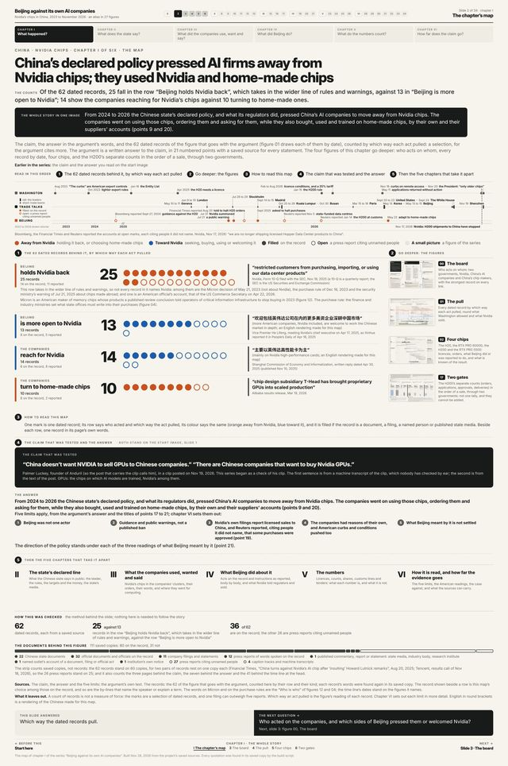
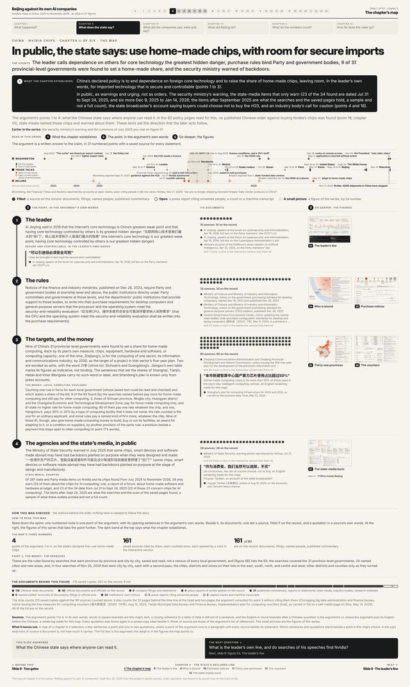
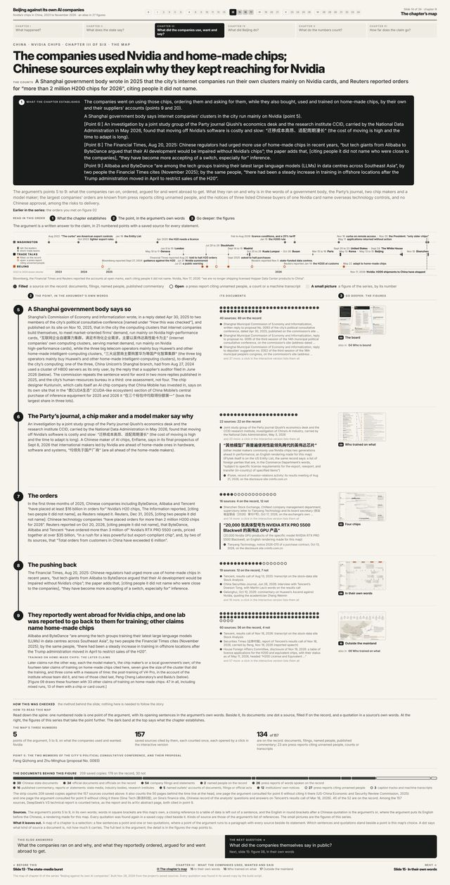
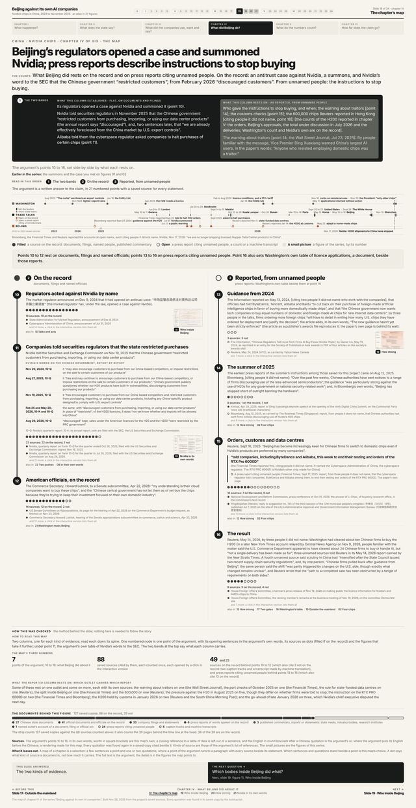
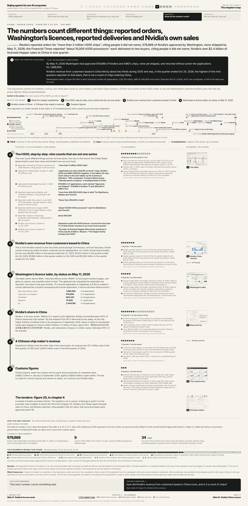
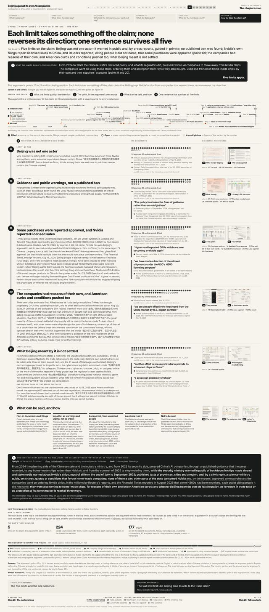

# Beijing against its own AI companies

**Nvidia’s chips in China, 2023 to November 2026: a series of 34 images, from the answer to the evidence behind it.**

This repository holds the 34 images, the argument behind them with 639 numbered references, a figure of 62 dated records, the two evidence files, 44 plain tables, the address and hash of every saved page but one (see `HELD_BACK.md`), and 46 outputs made from the record. Draft by Claude, Anthropic's model.

## What is new in this version

Seven slides have new headlines. Each now opens with a plain sentence that its slide already held, and the words that say how far a search reached stand beneath the headline; none was dropped. Slide 6 (figure 17): "Two governments stood between Chinese buyers and the H200". Slide 7 (the map of chapter II): "In public, the state says: use home-made chips, with room for secure imports". Slide 12 (figure 06): "81 of 93 local rules that pay for computing state no higher rate for home-made chips". Slide 13 (figure 07): "23 of 34 state-media items that only warned came within eight weeks of Nvidia being summoned". Slide 18 (the map of chapter IV): "Beijing’s regulators opened a case and summoned Nvidia; press reports describe instructions to stop buying". Slide 20 (figure 12): "Press reports: urging, instructions, withheld approval and approvals; no published order against buying Nvidia’s chips found". Slide 25 (figure 18): "Readings of Nvidia’s share in China fell; IDC’s figures for Chinese brands rose; Cambricon’s revenue grew". A statement of what was not found ("no published ... found") had stood in three headlines; it now stands in one, figure 12's, and beneath the headline on the other two. No slide was cut or moved, and no drawing changed.

The proposed headlines were first given to an independent machine reader among ten changes, two of them planted faults. It named both planted faults and faulted six of the eight real ones. One change was withdrawn (that slide keeps its headline) and four headlines were reworded to its points; these went back to the same reader, which passed them. Its sixth point was that figure 12's headline, by naming only urging, left the press reports softer than the slide's own ladder shows them; the headline now names the instructions too.

The record. The last version said that a search of the web for the documents that the argument and the two evidence files name and do not hold was under way. Its finds were saved, read against their saved copies by machine readers, and ruled on one by one. The argument rests on 639 sources, 541 of them on the record (634 and 537 in the last version), and 782 quotations were looked for in their saved copies and found (777 before). What a reader of the record would notice: the State Council's regulations on the import and export of goods are now read, and by their article 58 a temporary measure restricting or banning imports is to be announced before it takes effect, which the record's conclusion on what could exist in law without standing in a catalogue now says; the list of tax-exempt research goods the record cites belongs to a notice for one park, the Shenzhen park of the Hetao cooperation zone (财关税〔2026〕1号, in force from Feb 10, 2026), not to a national list; counts of home-made computing are given from their issuers' own pages where those could be saved, with two new entries (iFlytek's chairman on training on home-made computing; Henan Daily on one carrier's computing in the province); beside a witness's claim that two of 22 notable models were trained on home-made chips stand seven makers' own reports, with the sentence that which of them are among the 22 is not checked; the 1,500 steps of one institute's run on Ascend chips are steps of fine-tuning, as its own release lists them; one local reply gained its date (Jul 30, 2024); and the argument gives the day of David Sacks's remark at Salesforce's conference as Oct 14, 2025, from a newspaper's report of that afternoon, where the quote site that carries the excerpt dates it Oct 19.

16 of the 34 slides were built again and looked at: the seven with new headlines, and nine whose counts of sources, or whose date for that remark, follow the record. The other 18 are as they were. The counts pinned in the scripts of figures 06, 21, 23 and 25 were changed without a second reader; each was compared with the built page and looked at. The outputs that print a count or a reworded sentence of the argument were built again.

Not yet in this version: two local rules that the search of the web found are read and ruled on, and are not yet in the count of local rules that pay for computing (figure 06); a search of the announcements of the commerce ministry, customs and the State Council for a temporary measure on these chips has run, and its finds are not yet read against saved pages; nobody has yet checked by ear the recordings behind the quotations marked "not checked by ear"; an edition of the series made for a phone; a native reader for the Chinese version of the main figure. Nobody has yet watched the two videos among the outputs play through.

## The question and the answer

**Did Beijing's chip policy pull against China's own AI companies?**

Yes, on direction, with five limits: four on how, and one on what Beijing meant by it. China's declared chip policy pulled against the Nvidia chips its own AI companies were buying.

The answer's two sentences are the argument's own: the first stands under the title of `ARGUMENT_referenced.md`, the second opens its short version, `ARGUMENT_short.md`. The images and the record behind them give the five limits and the evidence for each.

## How to read it

Flip through all 34 images at https://kevinnbass.github.io/beijing-vs-its-labs/series/ with the arrow keys or a swipe, and click any part of an image for the documents behind it.

The images are built from the project’s saved sources; every quotation on an image was found in its saved copy by the build script. Each part of an image names its documents with their public addresses; the saved copies of press pages are not in this repository.

## The six chapters

### I. The whole story

China’s declared policy pressed AI firms away from Nvidia chips; they used Nvidia and home-made chips.

- [Figure 00 · The board](https://kevinnbass.github.io/beijing-vs-its-labs/series/03_figure-00_the-board.html): Who acts on whom: two governments, Nvidia, China’s AI companies and China’s chip makers, with the strongest record on every link.
- [Figure 01 · The pull](https://kevinnbass.github.io/beijing-vs-its-labs/series/04_figure-01_the-pull.html): Every dated record by which way each act pulled, round what Washington allowed and what Nvidia sold.
- [Figure 02 · Four chips](https://kevinnbass.github.io/beijing-vs-its-labs/series/05_figure-02_four-chips.html): The H20, the RTX PRO 6000D, the H200 and the RTX PRO 5500: licences, orders, what Beijing did or was reported to do, and what is known of the result.
- [Figure 17 · Two gates](https://kevinnbass.github.io/beijing-vs-its-labs/series/06_figure-17_two-gates.html): The H200’s separate counts (orders, applications, approvals, deliveries) in the order of a sale, through two governments: not one tally, and they cannot be added.

### II. The state’s declared line

In public, the state says: use home-made chips, with room for secure imports.

- [Figure 03 · The leader’s line](https://kevinnbass.github.io/beijing-vs-its-labs/series/08_figure-03_xi-line.html): Xi Jinping’s dated statements on core technology and chips, and the search that never finds Nvidia.
- [Figure 04 · Who is bound](https://kevinnbass.github.io/beijing-vs-its-labs/series/09_figure-04_who-is-bound.html): Whom the written purchase rules bind, ring by ring, and the evaluation lists.
- [Figure 20 · Purchase notices](https://kevinnbass.github.io/beijing-vs-its-labs/series/10_figure-20_tenders.html): A sample of public purchase notices.
- [Figure 05 · Thirty-one provinces](https://kevinnbass.github.io/beijing-vs-its-labs/series/11_figure-05_thirty-one-provinces.html): A map of the 31 provincial-level governments: which set a share for home-made computing.
- [Figure 06 · The vouchers](https://kevinnbass.github.io/beijing-vs-its-labs/series/12_figure-06_vouchers.html): Local computing vouchers: what each rule pays for home-made and for other computing.
- [Figure 07 · The state-media burst](https://kevinnbass.github.io/beijing-vs-its-labs/series/13_figure-07_state-media-burst.html): The state-media items on Nvidia chips that were found, by date, outlet and stance.

### III. What the companies used, wanted and said

The companies used Nvidia and home-made chips; Chinese sources explain why they kept reaching for Nvidia.

- [Figure 08 · In their own words](https://kevinnbass.github.io/beijing-vs-its-labs/series/15_figure-08_in-their-own-words.html): What the companies said about chips on results calls and in investor records.
- [Figure 09 · Who trained on what](https://kevinnbass.github.io/beijing-vs-its-labs/series/16_figure-09_who-trained-on-what.html): Training claims model by model, who makes each, and why the companies stayed with Nvidia.
- [Figure 10 · Outside the mainland](https://kevinnbass.github.io/beijing-vs-its-labs/series/17_figure-10_offshore.html): A map of what applications, filings and reports say about Nvidia chips outside the mainland.

### IV. What Beijing did about it

Beijing’s regulators opened a case and summoned Nvidia; press reports describe instructions to stop buying.

- [Figure 11 · Who inside Beijing](https://kevinnbass.github.io/beijing-vs-its-labs/series/19_figure-11_who-inside-beijing.html): A lane per state body: who held Nvidia back, who was more open to it.
- [Figure 12 · How strong](https://kevinnbass.github.io/beijing-vs-its-labs/series/20_figure-12_how-strong.html): The reported instructions on a ladder of six rungs, from urging to approval withheld; no published order found.
- [Figure 13 · Nvidia in its own words](https://kevinnbass.github.io/beijing-vs-its-labs/series/21_figure-13_nvidia-in-its-own-words.html): Nvidia’s sentence on the Chinese government, filing by filing, beside what it says of Washington.

### V. The numbers

The numbers count different things: reported orders, Washington’s licences, reported deliveries and Nvidia’s own sales.

- [Figure 14 · Nvidia’s China revenue](https://kevinnbass.github.io/beijing-vs-its-labs/series/23_figure-14_china-revenue.html): Nvidia’s revenue from customers based in China, quarter by quarter, and what the line is not.
- [Figure 16 · Washington’s table](https://kevinnbass.github.io/beijing-vs-its-labs/series/24_figure-16_washingtons-table.html): Washington’s table of licence applications, one by one.
- [Figure 18 · Share and rise](https://kevinnbass.github.io/beijing-vs-its-labs/series/25_figure-18_share-and-rise.html): Nvidia’s reported share in China and Chinese chip makers’ revenue.
- [Figure 19 · The customs lines](https://kevinnbass.github.io/beijing-vs-its-labs/series/26_figure-19_customs.html): What trade figures can and cannot show, set beside the 600,000 chips Reuters reported in Hong Kong.

### VI. How it is read, and how far the evidence goes

Each limit takes something off the claim; none reverses its direction; one sentence survives all five.

- [Figure 15 · Talks and acts](https://kevinnbass.github.io/beijing-vs-its-labs/series/28_figure-15_talks-and-acts.html): Trade talks against Beijing’s acts, the antitrust case, and the readings of what Beijing meant.
- [Figure 21 · Washington reads Beijing](https://kevinnbass.github.io/beijing-vs-its-labs/series/29_figure-21_washington-reads-beijing.html): American officials and bodies, statement by statement.
- [Figure 22 · Two pushes](https://kevinnbass.github.io/beijing-vs-its-labs/series/30_figure-22_two-pushes.html): Washington’s curbs and Beijing’s guidance on the same companies, and what their filings blame.
- [Figure 23 · The evidence map](https://kevinnbass.github.io/beijing-vs-its-labs/series/31_figure-23_evidence-map.html): Every source the argument cites, by point and by kind of evidence, and what is not held.
- [Figure 24 · Luckey’s 56 seconds](https://kevinnbass.github.io/beijing-vs-its-labs/series/32_figure-24_luckeys-56-seconds.html): The clip that started it, sentence by sentence.
- [Figure 26 · The case against](https://kevinnbass.github.io/beijing-vs-its-labs/series/33_figure-26_the-case-against.html): The best honest case that there was no real conflict, in seven parts, and the three things it cannot explain.
- [Figure 25 · The sentence](https://kevinnbass.github.io/beijing-vs-its-labs/series/34_figure-25_the-sentence.html): The one sentence that survives the five limits, clause by clause.

---

## The record behind the images

*The argument, its figure, the two evidence files, 44 plain tables, a list of every source but one with its address and, for each saved page, its hash, and the scripts that checked each quotation.*

Draft by Claude, Anthropic's model. First made public Nov 23, 2026.

This version assembled Nov 28, 2026 (UTC). 4,004 sources: 4,003 saved pages and one clip with no saved page (its words are a machine transcript); the saved text of 24 government documents is included, and of nothing else.

## The claim tested

Palmer Luckey, in a clip posted on Nov 19, 2026: "China doesn't want NVIDIA to sell GPUs to Chinese companies." [1] And next: "there are Chinese companies that want to buy Nvidia GPUs" [2]. The first sentence is from a machine transcript of the clip (0:11 to 0:16). The second is from the text of the post that carries the clip; the post begins it with the word Like, and so does a second machine transcript. A published transcript of the whole session, at the DealBook Summit 2026, has both sentences in the same words, but ends the first with two more words, like this: "Chinese companies like this. There are Chinese companies that want to buy Nvidia GPUs" [3]. That page does not say how its transcript was made. He goes on, by the machine transcript (0:18 to 0:36): "There's 600,000 H200 GPUs sitting in a port right now", because "China will not give them an import permit", "because they want to build an internal domestic processor industry, silicon industry, not build one that is dependent on the United States" [1]. Nobody has checked any of this by ear.

The question tested: did Beijing's chip policy pull against what China's own AI companies wanted?

## The answer in one paragraph

China's declared chip policy pulled against the Nvidia chips its own AI companies were buying. A Shanghai government body wrote in 2025 that the city's internet companies run their own clusters mainly on Nvidia cards [4]. Nvidia told the SEC in a report signed Nov 19, 2025: "The Chinese government has encouraged customers to purchase from our China-based competitors and restricted customers from purchasing, importing, or using our data center products" [5]. Five limits. No published ban was found in the policy pages read: state media warned in public (23 of the 34 items found that only warn are dated Jul 31 to Sept 24, 2025, and six more Dec 9, 2025 to Jan 14, 2026) [6] [7] [8], and the guidance against buying is known from press reports citing unnamed people [9]. Beijing was split: by Reuters, from unnamed people, its industry and commerce ministries approved some purchases [10]. Some chips were sold: $2.4 billion of Nvidia's licensed Hopper products (the chip family that includes the H200) to China in the quarter to Oct 25, 2026 [11] [12]. The companies had reasons of their own and used home-made chips as well: the president of ByteDance's cloud arm said in June 2026 "关于国产算力，我们用得非常多" (we use home-made computing a great deal) [13]. American curbs pushed too: the same Nvidia passage says "we are already effectively foreclosed from the China market by U.S. export controls" [5], and a Chinese listed company's board wrote in April 2026 that servers with Nvidia chips grew scarce "受美国人工智能芯片对华出口管制等因素影响" (under American export controls on AI chips to China, among other factors) [14]. And what Beijing meant is open: the US-China Economic and Security Review Commission read China's market regulator's accusation of antitrust violations against Nvidia, in September 2025, as leverage in trade talks [15]; the US Trade Representative, Jamieson Greer, in a Bloomberg Television interview (captions at 5:59, not checked by ear) calls whether China lets its companies buy the H200 "a sovereign decision for China" [16]; and Kevin Hassett, on Fox News on Sept 25, 2025, as Taiwan's Central News Agency reports him, said China wanted "讓華為壟斷所有在華晶片銷售" (to let Huawei monopolise all chip sales in China) [17].

The full argument is `ARGUMENT_referenced.md`: 21 points and 639 numbered references. Its answer is yes, on direction, with five limits. Beijing was not one actor. It warned in public and, by press reports, guided in private; no published ban was found. Nvidia's own filings report licensed sales to China, and Reuters reported, citing people it did not name, that some purchases were approved. The companies had reasons of their own, and American curbs and conditions pushed too. The argument considers whether Beijing meant its acts as lasting policy, as leverage in trade talks or as protection of its home market. The direction of the policy stands under each of the three readings of what Beijing meant by it (point 21).

Washington's side is on the record. The table of licence applications for Nvidia's H200 and AMD's MI325X, with their status on May 11, 2026, from the Commerce Department's Bureau of Industry and Security (BIS), was made public on Nov 19, 2026 by the House Foreign Affairs Committee, under its chairman's powers and by the committee's "unanimous consent" [18] [19]. 55% of the chips in the applications that BIS's summary of May 11, 2026 records were in applications returned without action, and the committee says that summary is incomplete: some applications are "not fully reflected in the May 11, 2026, summary document" [20]. The share is a script's sum of the table's 54 rows in `tables/house_licence_table.tsv`: 1,888,950 of 3,444,160 chips, in 9 applications [21]. The table gives no reasons. An application names a consignee: it is not an order, and an approval there is Washington's licence, not Beijing's.

## The two tiers

- **On the record.** Government documents, company filings, named people speaking on the record, published commentaries, reports or statements of state media, an industry body or a research institute, a named news outlet's account of a document, filing or official act, and an institution's own notice. In the argument their reference numbers are filled. In the figure their marks are filled. 551 of the 656 sources with an evidence tier (541 of the argument's 639); the 656 are the argument's 639 and 17 listed as extra references or used by the figure.
- **Reported.** Press reports that cite unnamed people, a research firm's, broker's or research group's counts as the press gave them, and caption tracks or machine transcripts that nobody has checked by ear. Their numbers and marks are open. 105 of the 656 (98 of the argument's 639).
- What Beijing is reported to have told companies in private (do not buy, cancel orders), the reported customs holds, and who is reported to have approved what are in the second tier: reported, not published policy. No published Chinese order against buying Nvidia chips was found in the 82 policy pages read.
- **Not classed here.** 3,348 more sources have no evidence tier in the repository. `sources.csv` gives their address and hash and the files that name them; it does not class them.
- `sources.csv` names the tier of every source with an evidence tier.

## How each quotation was checked

- Every source with a saved page was saved before it was quoted: the page as fetched, or a PDF saved by hand in a browser. The one clip with no saved page is quoted from a machine transcript of it. `sources.csv` gives each saved page's address, the time it was saved and the sha256 of the saved file.
- A script, `scripts/cn_srclib.py`, looks for each quotation in the saved copy. It ignores spacing, letter case and the style of quote marks, and nothing else. It refuses a string under 6 characters as too short to check.
- In the argument, words between straight double quotes must stand in the saved copy of a source cited on the same line. A statement made without quoting carries a hidden line, starting with two exclamation marks, that holds words of the page that back it. The builder writes nothing unless every one is found.
- The figure's builder does the same for the 532 quotations in `figure/figure_data.txt`.
- The check can fail: each builder plants a false quotation and stops if that one is found.
- The argument's own count, from the foot of `ARGUMENT_referenced.md`: 782 quotations, and 909 passages that back statements made without quoting, were looked for in the saved copies of 639 sources, and all were found.
- A quotation that is found shows what the source says, not that it is true.
- English in round brackets after Chinese or Japanese is our rendering, not an official translation.

## What is here

- `ARGUMENT_referenced.md`, `ARGUMENT_referenced.html`: the argument, with numbered references, as text and as a page.
- `ARGUMENT_short.md`: the argument in one paragraph, with its own references.
- `argument/`: the argument's text with saved ids in square brackets, its list of references, the short version's text, and `argument_refs_more.tsv`: 13 sources the argument no longer cites but other notes may.
- `OFFICIAL_RECORD.md`: the fuller record of government documents and filings (the first tier).
- `TIER2_REPORTING.md`: the fuller record of reporting (the second tier).
- `tables/`: 44 plain tab-separated tables, each listed below; every row names its saved source, or the table's first lines say where its rows come from.
- `figure/beijing_vs_labs.html`: the figure, 62 dated records in four rows, with panels of numbers beside them. `figure/beijing_vs_labs_top.png`, `_strip.png` and `_full.png` are three images of it; `figure/figure_data.txt` is its data, each record with the source's own words; `figure/figure_events.tsv` and `figure/template.html` are the numbered records as drawn and the page the builder fills.
- `sources.csv`: every saved source named in the files above but one (the one withheld: see below), other than the copies no longer cited that `tables/replaced_copies.tsv` names (see below): saved id, where it is named, kind, tier, label, the page's own title, address, time saved, sha256 of the saved file, whether its text is here, and a note (for a replacement copy, that it is one).
- `sources/<id>/meta.json`: for every saved source but one, its address, time saved and hash. `sources/<id>/text.txt` and `body_text.txt`: the saved text, for 24 government documents only.
- `scripts/`: the checker, the builders, `cn_outputs_verify.py` and `check_repo.py`. `.gitignore` keeps Python's cache folders out.
- `series/`: the 34 images, from the answer to the evidence behind it, each part naming the documents behind it; on the site at https://kevinnbass.github.io/beijing-vs-its-labs/.
- `index.html`, the site's first page (the start image), and `everything.html`, everything on one page (the argument, the figure, the tables and the 46 outputs): https://kevinnbass.github.io/beijing-vs-its-labs/everything.html
- `outputs/`: the 46 outputs made from this record (a thread, an article, figures, reference pages, two short videos, research notes), listed in [outputs/README.md](outputs/README.md).
- [LICENSE.md](LICENSE.md): the licence.

## The tables

Each table's own header lines give its columns and how it was made. Counts in the notes were made from these files by script.

- `tables/carriers_own_notices.tsv`: What the state telecom carriers' own notices, and others' accounts of the same purchases, say about the chips in the carriers' purchases of AI computing, 2023 to November 2026: each page classed by who states it, with counts of chip words on the page. 120 rows.
- `tables/chip_evaluations.tsv`: Each product in the security-and-reliability evaluation announcements of the China Information Technology Security Evaluation Center (itsec.gov.cn), as parsed from the saved pages: announcement, date, category, the row as printed. 180 rows.
- `tables/computing_centre_plans.tsv`: Plans, filings, bond disclosures and tenders for computing centres in mainland China that name Nvidia chips or, for comparison, home-made ones, each marked as an official page or a press account. 49 rows.
- `tables/customs_and_tariff_texts_read.tsv`: The pages a search read whole for a rule on importing a graphics processor, an AI accelerator or a server: China's customs and tariff announcements of January 2024 to November 2026 and what was read beside them, each with counts of chip words, customs numbers and words for licences, inspections and holds. 131 rows.
- `tables/house_licence_table.tsv`: The table of licence applications for Nvidia's H200 and AMD's MI325X with their status as of May 11, 2026, from the Commerce Department's Bureau of Industry and Security (BIS), one line per row, transcribed twice from the page images: date submitted, exporter, consignee, chip count, status, location, and a grouping of consignees made for totals (not the table's own). 54 rows.
- `tables/import_lists_read.tsv`: China's published lists of goods whose import needs a licence or is banned, 2024 to 2026, each searched whole for computers, computer parts and chips, with the control that shows the search could find them. 22 rows.
- `tables/labs_said.tsv`: What China's AI companies said about chip supply, January 2025 to November 2026: company, date, event, speaker, kind of source, exact words, saved id. 74 rows.
- `tables/labs_said_more.tsv`: The same for iFlytek and SenseTime, from their own results documents, investor records and exchange answers. 29 rows.
- `tables/largest_records_naming_no_chip.tsv`: The ten largest award or candidate records of the procurement table that name no chip, with the rule that picked them, the routes tried for the chip and what the saved pages say, as it stood on Nov 24, 2026. 10 rows.
- `tables/local_vouchers.tsv`: Local computing-voucher and subsidy rules: issuer, level, date, document, the rate for home-made and for other computing, the page's words, saved id. 20 rows.
- `tables/local_vouchers_classes.tsv`: The class of every local voucher rule in the two voucher tables, by the published counting rule (a rule in force whose official text or a full copy is saved and which states a share of the bill; one rule per government): pays more for home-made computing, pays for home-made computing only, or states no higher rate for home-made computing (one rate whatever the chip, or two rates by a type of facility the rule does not name); and, for a rule not counted, the part of the rule it fails. 247 rows.
- `tables/local_vouchers_more.tsv`: A second set of local voucher and subsidy rules, same columns. 227 rows.
- `tables/local_vouchers_other_provisions.tsv`: Provisions of the counted local voucher rules, other than the payment that is counted, that give home-made computing (chips, servers, computing facilities, computing power, or software adapted to home-made chips) something that other computing does not get: one row per provision, each read on the rule's saved copy. The class of a rule does not change by these rows: it is decided by the counted payment alone (tables/local_vouchers_classes.tsv). 10 rows.
- `tables/market_numbers.tsv`: Published numbers on the market for AI chips in China, one row per number: what is counted, by whom, for which period, with the page's words. Rows of different families measure different things and are not one series. 136 rows.
- `tables/miit_texts_word_counts.tsv`: Counts of eighteen words (home-made, chip, Nvidia, share and others) in 54 texts that China's Ministry of Industry and Information Technology published on its own site from 2023 to 2026 on computing, AI, electronics and telecom: one row per saved text. A count of words, not a reading of the texts. 54 rows.
- `tables/numbers_first_reports.tsv`: The numbers in the story: who first reported each among the saved pages, and how later reports changed it. 23 rows.
- `tables/nvidia_china_revenue.tsv`: Nvidia's revenue from customers in China, Hong Kong included, by period, in millions of dollars, from its filings, with the basis of the count (billing location, then headquarters). 28 rows.
- `tables/nvidia_wording_by_filing.tsv`: Nvidia's own words on China, one row per sentence, by filing, commentary or call. 113 rows.
- `tables/other_listed_buyers.tsv`: Other listed companies that in 2026 disclosed, or put out a tender for, a purchase or lease of servers with Nvidia chips, or a purchase of computing servers that was not completed. 11 rows.
- `tables/press_originals.tsv`: For each press reference of the argument: whether the copy held is a relay, and which copies of the original article were held. 54 rows.
- `tables/procurement_notices_oct_nov_2026.tsv`: Twenty-seven purchase notices for AI computing dated Oct 13 to Nov 24, 2026, from four universities' own purchasing sites and the national government-procurement site, each read from its saved page: the chip words as printed, whether an Nvidia model is named, and any home-made requirement. A reading sample, not a census. 27 rows.
- `tables/procurement_notices_sweep.tsv`: More purchase notices and filings on AI servers and cards, 2024 to November 2026, found by later searches and kept apart from the purchase records (a column says which are new to that table): how each names Nvidia, what it says on imports, and whether it requires or refuses Nvidia hardware by name. 61 rows.
- `tables/procurement_records.tsv`: Procurement records: telecom carriers' central purchases, awards naming Nvidia cards after August 2025, and tenders that require home-made chips, with stage, quantity and the page's words. 161 rows.
- `tables/provinces_31.tsv`: The 31 provincial-level governments: whether a published document sets a share for home-made computing, each by its plan's own measure (chips, equipment, hardware and software, or computing capacity), in the words of the document read, and what each row rests on (Shandong's plan is known only from press accounts). 31 rows.
- `tables/provincial_ict_plans.tsv`: The provincial communications administrations' five-year plans for their sector, searched as a class for a home-made share of computing, chips or equipment: 30 units other than Zhejiang, with what could be read for each and the control that shows the search could find a share. 30 rows.
- `tables/purchase_notices_2024_2025.tsv`: Purchase notices of January 2024 to June 2025 that name the H20, H800, A800, L20 or Nvidia; one row is a company's filing and one a scanned page read by eye. 35 rows.
- `tables/replaced_copies.tsv`: The saved copies no longer cited: the pages once taken from the Hong Kong exchange's news site and the copies once taken from two research firms' sites (idc.com, trendforce.com), each with the copy that stands in its place (or none), whether the two files are identical, and what differs. 39 rows.
- `tables/reported_claims_outlets.tsv`: For nine claims the argument gives as reported by unnamed people: the first report, second reports with their own sources, relays, and any denial. 9 rows.
- `tables/results_calls_authority_counts.tsv`: Counts from a search of 118 company texts (results-call transcripts of eight large companies and the records of four smaller ones) for the names of Chinese authorities beside a chip word: counts only, no sentence is copied. 48 rows.
- `tables/results_calls_read.tsv`: The 61 results-call transcripts that the word census counts words in, one row per call: the company, the call, its date, the saved id, the site that carries the transcript, and the markers of passages not translated. 61 rows.
- `tables/results_calls_word_census.tsv`: How many of 61 results-call transcripts of eight Chinese companies, February 2025 to November 2026, hold each of 20 words or word patterns (Nvidia, Huawei, H20, domestic chips, the Cyberspace Administration, customs and others), with the control word. 20 rows.
- `tables/rtx5500_buyers_later_notices.tsv`: Every notice of the three listed buyers of Nvidia's RTX PRO 5500 cards on the exchanges' disclosure site from Oct 1 to Nov 25, 2026 that the census of notices does not hold, with the Shenzhen exchange's letter to one of them: 26 notices, each with what it says on the cards. 26 rows.
- `tables/rtx5500_notices.tsv`: A census of listed companies' notices on the exchanges' disclosure site (cninfo), Sept 14 to Nov 24, 2026, whose titles name a contract, a purchase or computing: each notice's text searched for the RTX PRO 5500, with the sha256 of its PDF (the PDFs are not included). 333 rows.
- `tables/spokespeople_answers_census.tsv`: Chinese government spokespersons' answers about Nvidia chips, American chips or chip sales to China, found under one written rule. For the exchanges in the table, the foreign ministry's regular press conferences from December 2024 to Sept 13, 2026 were searched and the matches read twice. The commerce ministry's answers were found by search. The header records the later reading of regular foreign ministry conferences through Nov 25, 2026. The exchanges from that later reading are outside the table. No answer in that reading confirms or denies a restriction, an instruction or an approval. 31 rows.
- `tables/state_media_baseline_2024_2025h1.tsv`: A baseline for the state-media table: state and Party media items on Nvidia chips, January 2024 to June 2025, in that table's columns and by its rule for an item; gathered by other routes and from more papers (some rows are in People's Daily group papers that table does not cover), not a census, and not counted in that table. 174 rows.
- `tables/state_media_baseline_outside_scope.tsv`: Items that the searches for that baseline found and left out of it, each with the reason. 45 rows.
- `tables/state_media_items.tsv`: State and Party media items on Nvidia and its chips, July 2025 to November 2026: date, outlet, stance, key sentence and subject. The table distinguishes items on chips for AI computing from items on products that use an Nvidia chip. The items after Sept 24, 2025 are what the searches and the scan of the saved pages found, a sample of what these outlets printed and not a full count. 297 rows.
- `tables/talks_and_acts.tsv`: US-China trade meetings and calls, May 2025 to November 2026, with what each side's written readout, where one was found, says about chips (most name none), beside Beijing's dated acts on Nvidia chips. 50 rows.
- `tables/trade_annual_summary.tsv`: Yearly sums of monthly trade figures for several customs lines and places; 2026 is a part year. Different series measure different things. 528 rows.
- `tables/trade_derived_figures.tsv`: Every sum and ratio stated in the trade-data report (not included), computed from its tables. 76 rows.
- `tables/us_officials_statements.tsv`: Named American officials on China buying, blocking or bargaining over Nvidia chips: date, official, venue, cue time or official text, exact words. 35 rows.
- `tables/wuhan_university_result_notices.tsv`: Result notices of purchases by filed bidding that Wuhan University's procurement centre published on its own site, June 2025 to November 2026, picked by titles on graphics cards, GPUs, servers and AI computing: 81 notices, each with its date, its price, and the Nvidia words and home-made words found on the page. 81 rows.
- `tables/xi_items_database_check.tsv`: A test of how complete the People's Daily database of Xi Jinping's speeches and activities is: 156 items of 2023 to November 2026 taken from Xinhua's lists and Qiushi's contents for their words on chips, computing power, AI, American firms or curbs, each looked for in the database, with the verdict and how it was reached. 156 rows.
- `tables/xi_searches.tsv`: The searches for Xi Jinping's words on Nvidia and its chips, with their controls: site, words, period, results reported. 92 rows.

## Which texts are included

- The saved text of a source is included only where two things hold. The argument or the figure classes the source as a government document or an official's words on the record. And the saved page stands on a government site or on the Party members' own site (addresses ending in .gov.cn or .gov, and 12371.cn).
- 207 sources pass both tests: 171 Chinese and 36 American. The text of 24 is included. Each was read whole before it went in.
- Of the American ones, the text of 1 is included: the Senate appropriations committee's page for the hearing of Apr 22, 2026 [22].
- For every other saved page but one, the address and the hash are given, never the text.

## How to rebuild

- **From this repository alone:** `python3 -I scripts/check_repo.py`. It compares the included texts with the hashes in `sources.csv` and looks for every quotation whose source text is included. At assembly it found 121 quotations and hidden statements in 24 sources, and counted 2,121 as not checkable here.
- **In full:** `python3 -I scripts/cn_argument_build.py` builds the argument and `python3 -I scripts/cn_figure_build.py` builds the figure (add `--png` for the images, which needs Playwright). They write nothing unless every quotation is found (the argument's builder here passes over the clip transcripts, which are not included: see below). In this repository they therefore stop and list the quotations whose pages are not included. To run them in full, save each page named in `sources.csv` yourself as `sources/<id>/text.txt`, beside the `meta.json` already there.
- `scripts/cn_doc_build.py` and `scripts/cn_has.py` run the same check on another document and on a list of quotations. Their own control reads a press page, so they also need the pages saved first.
- Python 3 with its standard library is enough for everything but the images.

## Files changed from the working copies

- **Paths in the scripts.** The project's own copies of `scripts/cn_srclib.py`, `scripts/cn_argument_build.py`, `scripts/cn_doc_build.py`, `scripts/cn_has.py` and `scripts/cn_figure_build.py` read its folders: `research/primary/<id>` for saved pages and `research/cn_chip_policy_20261120` for the argument, the figure and the tables. One docstring named an interpreter by its full local path. The copies here read this repository's folders: `sources/<id>`, `argument/`, `figure/`, `tables/` and the top folder.
- **The clip transcripts.** They are not included, so `scripts/cn_argument_build.py` here passes over them where the working copy would stop. Quotations from the clip then count as not found.
- Nothing else in those five scripts was changed. `scripts/cn_outputs_verify.py` is copied unchanged but for one header line. It checks again the further notes and figures made from this record, in the project's own folder of them. It needs that folder, which is not part of this repository, so it does not run here; a copy of those notes and figures, less what `HELD_BACK.md` lists, is under `outputs/`. `scripts/check_repo.py` was written for this repository.
- **The two evidence files.** In `OFFICIAL_RECORD.md` and `TIER2_REPORTING.md`, six mentions of the project owner's first name were replaced by the words the project's owner, or the owner. Nothing else in them was changed.
- **Caption tracks.** For 9 caption tracks, the address given is the video's, not the signed request address the track was fetched through.
- **One table and the tables' comment lines.** In `tables/rtx5500_notices.tsv` the folder on the project's machine that keeps the census's PDFs is not named. Where a comment line of a table named a copy no longer cited, it now points to `tables/replaced_copies.tsv` instead.
- **Page titles.** For 30 saved pages the page's own title is not given in `sources.csv` or `meta.json`: the argument does not print it, or it names a matter this project leaves out. Their address and hash are given.
- **Everything else** is copied from the working files as it stands, so the files' own text still names saved copies as `research/primary/<id>` (here each saved copy's record is `sources/<id>/meta.json`, under the same id), and working folders and notes that are not part of this repository (`HELD_BACK.md` gives each kind left out). Where the public copy changes a line of its text files (a folder name of the project's machine made relative, a site key written out, a page that called itself local or not published, a pointer to a file that is held back, a phrase on copies since withdrawn), `HELD_BACK.md` lists each kind of change with the number of files it touched.

## What is not included, and why

- **The text of press pages, company pages, filings, call transcripts, notices, caption tracks and posts** (395 sources). It belongs to its publishers. `sources.csv` gives the address of each page and the sha256 of the copy that was checked.
- **The text of official material that stands on some other site** (53 sources, on api.twitter.com, cdgaoqi.com, cggl.cug.edu.cn, cj.sina.com.cn, cpc.people.com.cn, en.cisce.org.cn, jhsjk.people.cn, m.chinastor.cn, m.jiemian.com, m.mxcwl.com, m.sohu.com, m.voc.com.cn, news.bjd.com.cn, pdf.dfcfw.com, reportdocs.static.szse.cn, rollcall.com, wipolex-res.wipo.int, world.people.com.cn, www.10100.com, www.bernama.com, www.cfr.org, www.everycrsreport.com, www.hzarchives.org.cn, www.idctalk.com, www.investsh.org.cn, www.investxiamen.org.cn, www.jitinfo.net, www.keceyun.com, www.miti.gov.my, www.news.cn, www.opczone.cn, www.presidency.ucsb.edu, www.qhhnnews.com, www.rev.com, www.smartcity.team, www.sohu.com, www.tc260.org.cn, www.thewirechina.com, www.xinhuanet.com, www.yfbzb.com, www.yicai.com, www.zhongcaigou.com, www3.xinhuanet.com, zhbb.cumt.edu.cn). These are copies and transcripts kept by trade sites, business papers, state media, transcript services, councils, universities and archives. Address and hash only.
- **The text of 183 government documents on government sites** that the builder of this copy had not read whole. Address and hash only; `sources.csv` marks each as a government document not yet read whole by the builder.
- **The text of the 3,348 sources not classed here.** Address and hash only.
- **Copies no longer cited** (39 saved ids): 20 pages once taken from the Hong Kong exchange's news site, and 19 copies once taken from two research firms' sites, idc.com and trendforce.com. None of them is in this repository: no text, no saved record, and no row in `sources.csv`. `tables/replaced_copies.tsv` names each and gives the copy that stands in place of each (from a company's own investor site, another mirror or another carrier's page) or says that none is held; 28 replacement copies are listed in `sources.csv`, each with a note that it is one.
- **Files on an investor-relations vendor's server.** 5 of the replacement copies stand on ea-cdn.eurolandir.com, whose terms allow personal, non-commercial use. Their addresses and hashes only, like every other company filing.
- **One saved page withheld** (1): it is named in a table, but its address and record are not given here, pending a decision on publishing them.
- **Both clip transcripts and the clips' video.** The transcripts are a speech program's and were not checked by ear. The clips belong to their makers. The argument quotes short passages of one transcript and says so.
- **The saved page bodies** (HTML and PDF). Only text is included: `text.txt` as saved and, for 8 pages whose saved text misses the passage quoted, a `body_text.txt` made from the saved body by removing scripts, styles and tags.
- **The working notes:** the folders of notes and reports that the evidence files and the tables name, the notes on the policy pages read and on Xi Jinping's statements, the trade-data report, and the search files. They are not part of this repository.
- **`ARGUMENT_short.txt`**, which the working builder also writes: the short version again under another file name.
- **`scripts/render_and_look.py`**, a tool for looking at a page before release, which two docstrings mention.
- What of the outputs and of the series' working folder was left out, and why: [HELD_BACK.md](HELD_BACK.md).

## References of this page (the argument has its own list)

Each entry: its kind; what it is; the saved page's own title where the record holds one; the address; the id of the saved copy.

[1] Caption track or machine transcript, not checked by ear. Palmer Luckey, in a clip of 56 seconds posted on X by @overton_news, Nov 19, 2026. Words from a machine transcript of the clip; nobody has checked them by ear. https://x.com/overton_news/status/2123392702821580811

[2] Press report of words spoken on the record. Post on X by @overton_news, Nov 19, 2026, which carries the clip of Palmer Luckey and gives his words as text. The post does not name the programme. https://x.com/overton_news/status/2123392702821580811 Saved copy: cnpol-x-overton-2123392702821580811

[3] Press report of words spoken on the record. The Singju Post, transcript of Palmer Luckey's interview on stage at the DealBook Summit 2026, with Andrew Ross Sorkin. The page does not say how the transcript was made or the day of the session. Page title: Transcript: Palmer Luckey Interview on War 2.0 – DealBook Summit 2026 – The Singju Post. https://singjupost.com/transcript-palmer-luckey-interview-on-war-2-0-dealbook-summit-2026/ Saved copy: cn-clips-singju-luckey

[4] Chinese state document. Shanghai Municipal Commission of Economy and Informatization, written reply to proposal No. 0093 of the city's political consultative conference, dated Apr 30, 2025; published on the commission's site on Nov 10, 2025. Page title: 对市政协十四届三次会议 第0093号提案的答复. https://www.sheitc.sh.gov.cn/rddbta/20251110/e6cfe3270ca5483e93cbc55701492e6d.html Saved copy: cn-counter-b11-5

[5] Company filing or statement. Nvidia, quarterly report on Form 10-Q for the quarter ended Oct 26, 2025, filed with the US Securities and Exchange Commission; signed Nov 19, 2025. https://www.sec.gov/Archives/edgar/data/1045810/000104581025000230/nvda-20251026.htm Saved copy: man-ms-sec-10q-2025-10

[6] Published commentary, report or statement (state media, industry body, research institute). Global Times, Jul 31, 2025 (Ma Tong), news report of the summons quoting the telecom industry expert Xiang Ligang. Page title: China's cyberspace regulator summons Nvidia over potential security risks in H20 chips. https://www.globaltimes.cn/page/202507/1339752.shtml Saved copy: cn-ga02-gt-cac-summons-news-202507

[7] Published commentary, report or statement (state media, industry body, research institute). People's Daily's commentary account (人民日报评论), a signed piece of Aug 1, 2025, as carried by Beijing Daily's site. Page title: 人民日报评论：英伟达，让我怎么相信你？. https://xinwen.bjd.com.cn/content/s688c9a7ae4b0aabe0a046f83.html Saved copy: cn-acts-peoplesdaily-bjd-20250801

[8] Published commentary, report or statement (state media, industry body, research institute). Science and Technology Daily, report of a forum on information security, Sept 24, 2025. The sentence relied on is the reporter's summary of what academician Shen Changxiang stressed. Page title: 第九届国家信息安全与自主可控战略高层论坛在京举行. https://www.stdaily.com/web/gdxw/2025-09/24/content_406839.html Saved copy: cn-media-stdaily-security-forum

[9] Press report citing unnamed people. Bloomberg, as carried by The Business Times (Singapore), Sept 28, 2024: report, from people it does not name, that Chinese regulators were discouraging companies from buying Nvidia's H20 chips. Page title: China urges local companies to stay away from Nvidia’s chips. https://www.businesstimes.com.sg/companies-markets/china-urges-local-companies-stay-away-nvidias-chips Saved copy: cn-factions-bloomberg-flexibility-202409-relay1

[10] Press report citing unnamed people. Reuters, Jan 30, 2026, as carried by Yahoo Finance. Page title: Exclusive-China conditionally approves DeepSeek to buy Nvidia's H200 chips - sources. https://finance.yahoo.com/news/exclusive-china-conditionally-approves-deepseek-065114115.html Saved copy: cn-ga31-sv1-reuters-deepseek-yahoo

[11] Company filing or statement. Nvidia, results call for the third quarter of its fiscal year 2027 (the quarter ended Oct 25, 2026): the transcript on Nvidia's investor file host (s201.q4cdn.com). https://s201.q4cdn.com/141608511/files/content_files/NVDA-3Q27-Earnings-Transcript.pdf Saved copy: cn-o38-nvda-q3fy27-call-transcript-pdf

[12] Press report of words spoken on the record. Reuters, Nov 18, 2026, as carried by AOL, reporting Nvidia's then interim chief executive on its results call. Page title: Nvidia stops shipping US-approved AI chips to China - AOL. https://www.aol.com/articles/nvidia-stops-shipping-us-approved-091611000.html Saved copy: cn-acts-reuters-halt-20261118-relay2

[13] Press report of words spoken on the record. Jiemian, Jun 23, 2026: interview with Volcano Engine's president Tan Dai. Page title: 对话火山引擎谭待：短剧只是一个小场景，Seedance能服务实体产业|界面新闻 · 科技. https://www.jiemian.com/article/14631587.html Saved copy: cn-ga31-labsbytep3-11

[14] Company filing or statement. Huina Technology, notice 2026-026 on its Sichuan computing venture's profit pledge, Apr 25, 2026. https://static.cninfo.com.cn/finalpage/2026-04-25/1225194335.PDF Saved copy: cn-ga31-dcstatewest-13

[15] Official document, or an official on the record. US-China Economic and Security Review Commission, 2025 report to Congress, November 2025: the whole report, whose chapter 1 is also listed on its own (the passage cited is in chapter 1 and rests on Reuters and the Financial Times). https://www.uscc.gov/sites/default/files/2025-11/2025_Annual_Report_to_Congress.pdf Saved copy: cn-le03-uscc-2025-full

[16] Caption track or machine transcript, not checked by ear. US Trade Representative Jamieson Greer, interview on Bloomberg Television posted May 15, 2026 ("Greer: US, China Willing to Continue Trade Truce"): the video's English caption track (its maker is not stated; it is not YouTube's automatic track), not checked by ear; the words quoted are at 5:59. https://www.youtube.com/watch?v=ckzJQyMyCoE Saved copy: cn-le01-greer-bbg-20260515-subs-ttml

[17] Press report of words spoken on the record. Central News Agency, Sept 26, 2025: report of Kevin Hassett on Fox News on China and Nvidia's chips. Page title: 白宮經濟顧問示警 中國若無輝達晶片恐輸AI競賽 | 國際 | 中央社 CNA. https://www.cna.com.tw/news/aopl/202509260244.aspx Saved copy: cn-ga31-usoffwhitehouse-14

[18] Official document, or an official on the record. House Foreign Affairs Committee, chairman's press release of Nov 19, 2026 on making public the licence information for Nvidia's and AMD's chips to China. Page title: Chairman Brian Mast Exercises Legislative Authority to Publicly Release AI Chip License Information for China. https://foreignaffairs.house.gov/news/press-releases/chairman-brian-mast-exercises-legislative-authority-to-publicly-release-ai-chip-license-information-for-china Saved copy: cn-labs-us-chip-licences-20261119

[19] Official document, or an official on the record. House Foreign Affairs Committee, the ranking member's remarks at the business meeting of Nov 19, 2026, on the committee Democrats' site. Page title: Meeks Delivers Remarks During HFAC Disclosure of BIS Licenses of NVIDIA & AMD Chips to China | House Foreign Affairs Committee. https://democrats-foreignaffairs.house.gov/2026/11/meeks-delivers-remarks-during-hfac-disclosure-of-bis-licenses-of-nvidia-amd-chips-to-china/ Saved copy: cn-le04-meeks-remarks-20261119

[20] Official document, or an official on the record. House Foreign Affairs Committee, disclosure of Nov 19, 2026, made by the full committee (its chairman's release; approved by unanimous consent at a business meeting; the files are on the committee Democrats' site): the committee's summary, which cites a BIS summary dated May 11, 2026 (BIS: the Commerce Department's Bureau of Industry and Security). https://democrats-foreignaffairs.house.gov/wp-content/uploads/2026/11/11.19.26-ECRA-Information-Disclosure-HFAC-Summary.pdf Saved copy: cn-usdocs-hfac-summary-20261119

[21] Official document, or an official on the record. House Foreign Affairs Committee, disclosure of Nov 19, 2026: a table of licence applications for the H200 and equivalent chips, with their status as of May 11, 2026, headed "H200 License and Equivalent Application Status as of May 11, 2026" (its text layer is out of order; the rows were read from the page images). https://democrats-foreignaffairs.house.gov/wp-content/uploads/2026/11/11.19.26-ECRA-Information-Disclosure-of-BIS-License-Decisions.pdf Saved copy: cn-usdocs-hfac-decisions-20261119

[22] Official document, or an official on the record. US Senate Committee on Appropriations, its page for the hearing of Apr 22, 2026 on the Commerce Department's budget request, as fetched on Nov 23, 2026. Page title: A Review of the President’s Fiscal Year 2027 Budget Request for the Department of Commerce | United States Senate Committee on Appropriations. https://www.appropriations.senate.gov/hearings/a-review-of-the-presidents-fiscal-year-2027-budget-request-for-the-department-of-commerce Saved copy: cn-o37-senate-hearing-page-b

Build check: 14 quotations, and 20 passages that back statements made without quoting, were looked for in the saved copies of 22 sources and all were found; a made-up quotation, put in as a test, was not found. 18 sources are documents, filings or named people on the record, or published commentaries, reports or statements of state media, industry bodies or research institutes, institutions' own notices and named outlets' accounts of documents; 4 are press reports citing unnamed people, counts or machine transcripts. A quotation that is found shows what the source says, not that it is true.
